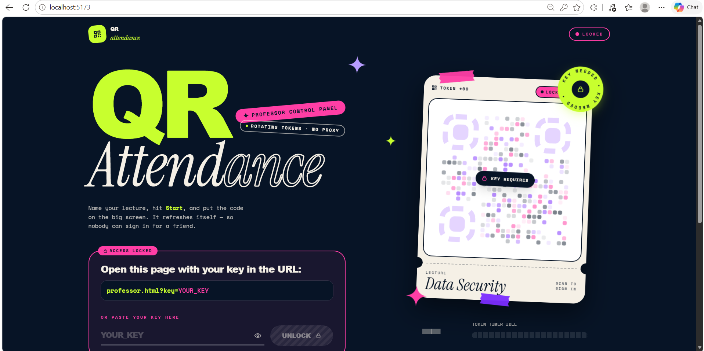
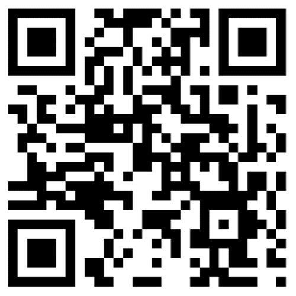
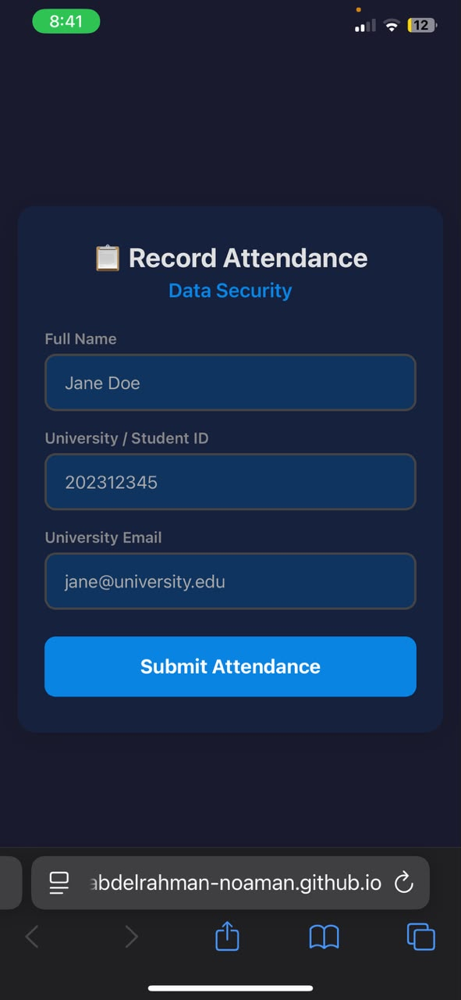
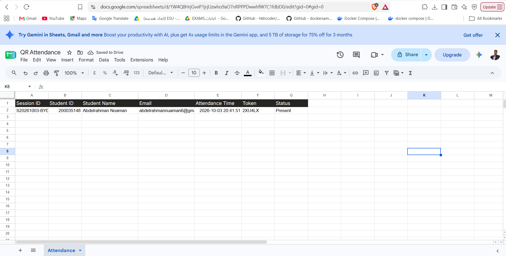
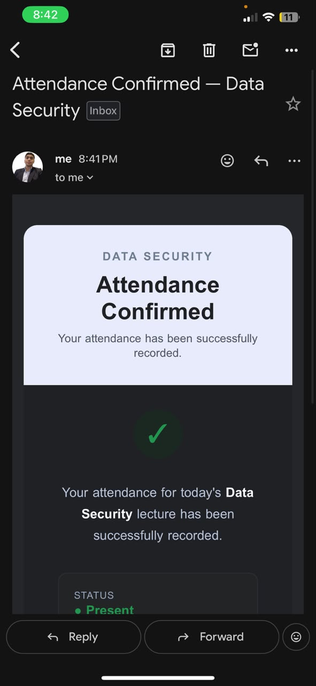
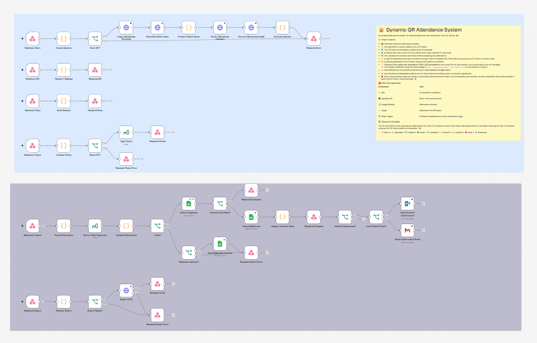

# 🔐 Dynamic QR Attendance System

<p align="center">
  <strong>Attendance that expires before it can be reused.</strong>
  <br><br>
  A short-lived, token-based attendance system built with
  <strong>n8n</strong>, <strong>Webhooks</strong>, and
  <strong>Google Workspace</strong>.
</p>

<p align="center">
  <a href="https://youtu.be/6oHII9qabew">
    
  </a>
  
  
  
  
</p>

---

## 📑 Table of Contents

- [Demo](#-demo)
- [Overview](#-overview)
- [The Problem](#-the-problem)
- [The Idea](#-the-idea)
- [Key Features](#-key-features)
- [How It Works](#-how-it-works)
- [System Demo](#-system-demo)
- [n8n Workflow](#️-n8n-workflow)
- [Location Verification](#-location-verification)
- [Architecture](#️-architecture)
- [Tech Stack](#️-tech-stack)
- [Repository Structure](#-repository-structure)
- [Setup](#-setup)
- [Validation Scenarios](#-validation-scenarios)
- [Known Limitations](#️-known-limitations)
- [Future Improvements](#-future-improvements)
- [What I Learned](#-what-i-learned)
- [Documentation](#-documentation)
- [Author](#-author)

---

## 🎥 Demo

<p align="center">
  <a href="https://youtu.be/6oHII9qabew">
    
  </a>
</p>

<p align="center">
  <strong>▶ Watch the project walkthrough</strong>
  <br>
  Problem → Live Demo → n8n Workflow
</p>

---

## ✨ Overview

Traditional QR attendance relies on a static QR code that remains valid for the duration of the attendance session.

That creates a simple problem:

> **A student can screenshot the QR code and share it with someone who is not attending.**

This project explores a lightweight alternative:

> **What if the QR code itself expired before it could be reused?**

The system generates **short-lived QR tokens** that rotate approximately every **15 seconds**.

When a student scans the QR:

1. n8n validates the session and token.
2. A temporary **HMAC-SHA256 signed ticket** is issued.
3. The student gets a limited window to complete the attendance form.
4. The final submission is validated again.
5. Duplicate attendance is rejected.
6. Valid attendance is recorded in Google Sheets.
7. A confirmation email is sent automatically through Gmail.

This is primarily an **automation and software engineering project**, demonstrating:

- Workflow orchestration
- Webhook design
- Temporary state management
- Token validation
- Cryptographic signing
- API integration
- Duplicate prevention
- Google Workspace automation
- Lightweight frontend/backend integration

---

## 🎯 The Problem

A typical static QR attendance flow looks like this:

```text
Professor
    │
    ▼
Static QR Code
    │
    ▼
Student scans
    │
    ▼
Google Form
    │
    ▼
Attendance recorded
```

The QR itself does not change.

Therefore, a screenshot of the QR remains useful for as long as the attendance session is active.

The goal of this project was **not** to build a massive attendance platform. The goal was to introduce a small, meaningful security improvement using **short-lived access tokens** and **server-side validation**.

---

## 💡 The Idea

Instead of keeping one QR code active for the whole lecture:

```text
┌─────────────────────────────┐
│       STATIC QR CODE        │
│                             │
│     Valid for the lecture   │
└─────────────────────────────┘
```

the system continuously rotates the underlying token:

```text
TOKEN #1
   │
   ├── Valid ~15 seconds
   ▼
TOKEN #2
   │
   ├── Valid ~15 seconds
   ▼
TOKEN #3
   │
   ├── Valid ~15 seconds
   ▼
TOKEN #4
   │
   └── ...
```

The important part is that **expiration is enforced by the backend**, not just by the browser.

> The browser displays the QR.  
> n8n decides whether the QR is valid.

---

## ⚡ Key Features

| Feature | Description |
|---|---|
| 🔄 **Dynamic QR** | QR tokens rotate approximately every 15 seconds |
| ⏱️ **Short-lived tokens** | Expired tokens are rejected by the backend |
| 🔐 **Signed tickets** | HMAC-SHA256 protects temporary attendance tickets |
| 🛡️ **Server-side validation** | The browser is never trusted |
| 🚫 **Duplicate prevention** | The same student cannot register twice in one session |
| 📗 **Sheet per session** | Every **Start** creates a brand-new Google Sheet with the Attendance columns |
| 📊 **Google Sheets** | Attendance records are stored automatically in that session's sheet |
| ⬇️ **Excel download** | **Stop** returns the session sheet with a one-click `.xlsx` download |
| 📧 **Gmail confirmation** | Successful attendance triggers an email |
| 🛑 **Session control** | Stopping a session invalidates pending attendance |
| ⚙️ **n8n orchestration** | Backend logic and integrations are handled through n8n |

---

## 🔄 How It Works

### 🔐 Security Model

The system uses multiple validation layers rather than trusting the QR code alone.

#### 1. Short-Lived QR Token

Each QR token is valid for approximately 15 seconds.

```text
Issued:  12:30:00
Expires: 12:30:10

12:30:05  ✅ Valid
12:30:09  ✅ Valid
12:30:11  ❌ Expired
```

- The `/dqr-qr` endpoint rotates the active token when it expires.
- The `/dqr-check` endpoint independently verifies the token timestamp, so an old QR cannot be accepted just because it was previously valid.

#### 2. Session Validation

A token must belong to the **currently active** attendance session.

The system maintains session state containing:

- Session ID
- Active status
- Current token
- Token issue time
- Lecture information

#### 3. Signed Temporary Ticket

After a valid QR scan, n8n generates a temporary ticket.

```text
Session ID
     +
Token
     +
Expiration
     │
     ▼
HMAC-SHA256
     │
     ▼
Signed Ticket
```

The ticket is valid for approximately **3 minutes**.

This gives the student enough time to complete the form **without** keeping the QR token itself valid for the entire submission period.

#### 4. Final Submission Validation

The final submission is validated again before attendance is recorded. The system checks:

- Ticket signature
- Ticket expiration
- Session ID
- Active session
- Required fields
- Basic email format
- Duplicate attendance

#### 5. Location Verification

The dashboard and the student page share one policy module,
`frontend/location-core.js`, so a reading is validated by the same rules no
matter who submits it. The **student** browser reading is acquired with:

```text
enableHighAccuracy: true
maximumAge: 0                # cached fixes are refused
timeout: 12000 ms per call   # browser hint
maxAttempts: 3               # sequential fresh readings
totalTimeoutMs: 30000        # bounded window, then a clear error
```

The most accurate *fresh* reading wins. A reading is accepted only when the
coordinates are in range, the accuracy is a positive number, and the capture
timestamp is recent — an old reading is never reused as the current position.
Requesting high accuracy does **not** guarantee an accurate position; the
reported accuracy is displayed in meters so the reader can judge it. The
professor is not asked for a GPS reading at all: the laptop's coarse fix cannot
gate the session, and it is never used as the reference point.

The session reference is **not** the professor's laptop GPS. Indoor laptop
fixes are routinely ±150 m or worse and can never satisfy a 50 m quality gate,
so the professor selects the lecture hall on an interactive map in the control
panel:

- search a place (OpenStreetMap Nominatim), or click/drag the pin to the room;
- press **Confirm Lecture Location**;
- the confirmed latitude/longitude and `confirmedAt` timestamp are stored in n8n
  state as the session reference.

A map-confirmed reference carries **no GPS accuracy requirement** — it is an
administrative statement of where the class meets, not verified proof that the
professor is standing there. It must be confirmed within the last hour.

After QR validation the student is asked for their own real browser reading.
The workflow validates it, calculates the Haversine distance on the backend
against the confirmed hall, and applies:

```text
ATTENDANCE_RADIUS_METERS = 100        # student distance from the hall
MAX_GPS_ACCURACY_METERS = 50          # student reported accuracy ceiling
MAX_LOCATION_AGE_SECONDS = 30         # student reading freshness
LECTURE_LOCATION_MAX_AGE_MINUTES = 60 # map confirmation freshness
```

Outcomes are terminal — there is no review state:

```text
ACCEPTED / VERIFIED         distance <= 100 m and accuracy <= 50 m
REJECTED / OUTSIDE_RADIUS   distance >  100 m
REJECTED / LOW_ACCURACY     reported accuracy > 50 m
REJECTED / STALE_LOCATION   reading older than 30 s
REJECTED / INVALID_LOCATION out-of-range coordinates / accuracy / timestamp
REJECTED / LECTURE_LOCATION_*  the confirmed hall is missing, invalid or stale
```

Only `ACCEPTED / VERIFIED` submissions are written to Google Sheets and emailed.
Accuracy problems are never reported as being outside the radius, and the radius
is never widened to compensate for a poor fix. The browser never decides the
outcome.

#### 6. Duplicate Prevention

Before inserting a record, the workflow checks the combination of:

```text
(Session ID + Student ID) OR (Session ID + Device ID)
```

This prevents the same student or browser from registering multiple times
during the same attendance session. The device ID is stored in browser storage,
so it is an additional control rather than a guaranteed hardware identifier.

#### 7. Session Stop

When the professor stops the session:

```text
Active Session
      │
      ▼
    STOP
      │
      ▼
Session inactive
      │
      ├── New scans        → ❌ Rejected
      │
      └── Pending tickets  → ❌ Invalid
```

The stop response also carries the session's workbook, so the dashboard can
show it and offer the Excel download immediately.

#### 8. Per-Session Attendance Sheet

Every session writes to **its own** spreadsheet instead of one shared log:

```text
Press START
      │
      ▼
n8n creates a new spreadsheet
"Attendance - <Lecture> - <Session ID>"
      │
      ├── one tab:  Attendance
      ├── row 1:    the 17 Attendance headers (bold, frozen)
      └── column B: plain text, so Student IDs keep leading zeros
      │
      ▼
Students check in → rows are appended to that sheet only
      │
      ▼
Press STOP  →  dashboard shows the sheet
      │
      ├── Open sheet      → Google Sheets
      └── Download .xlsx  → /dqr-export streams the workbook
```

A session only goes live once its workbook exists **and** its header row was
written; otherwise the start is refused (`WORKBOOK_CREATE_FAILED` /
`WORKBOOK_SETUP_FAILED`) and nothing is left half-started.

The download is served by the workflow with its own Google credential, so it
works regardless of which Google account the professor is signed in with. If
that call fails, the dashboard falls back to Google's own
`export?format=xlsx` link.

---

## 🎬 System Demo

### 👨‍🏫 Professor Dashboard

The professor dashboard allows the instructor to:

- Start an attendance session (which creates that session's Google Sheet)
- Display the current QR code
- Monitor the token countdown
- Stop the attendance session
- Open the session sheet and download it as Excel

<!-- TODO: Add docs/images/professor-dashboard.png -->
<p align="center">
  
</p>

### 🔄 Dynamic QR Rotation

The QR code automatically changes as the current token expires. This is the core behavior of the system.

<!-- TODO: Add docs/gifs/qr-rotation.gif showing at least two QR rotations -->
<p align="center">
  
</p>

### 👨‍🎓 Student Attendance

After scanning the current QR, the student is taken to the attendance page.

The scan is validated **before** the student receives a temporary signed ticket.

<!-- TODO: Add docs/images/student-attendance.png -->
<p align="center">
  
</p>

### 📊 Attendance Recording

Once the submission passes validation, n8n records the attendance in the
session's own Google Sheet — the one created when the professor pressed Start.

<!-- TODO: Add docs/images/google-sheets.png. Use synthetic test data. -->
<p align="center">
  
</p>

Example row format:

```text
Session ID | Student ID | Device ID | Student Name | Email | Attendance Time | Token | Status | Instructor Latitude | Instructor Longitude | Student Latitude | Student Longitude | Distance (m) | Instructor GPS Accuracy (m) | Student GPS Accuracy (m) | Location Status | Location Timestamp | Legacy review column (unused)
```

### 📍 Location Verification

The professor dashboard embeds a **dark Leaflet map** with place search, a
draggable pin, live latitude/longitude readout and a **Confirm Lecture Location**
button plus a confirmation indicator. `Start` is disabled until a valid lecture
location is confirmed, and the confirmed hall is shown on the map and in the
stats strip. A secondary "Centre on my device" button can centre the map on the
laptop's (possibly very coarse) fix, and it explicitly says that a device fix is
not proof of the room. The student page requests location only after the QR
passes `/dqr-check`, shows each attempt's reported accuracy, and refuses to
submit when no reading meets the 50 m target. Student geolocation requires
HTTPS (except localhost) and explicit browser/device permission.

**Map providers:** tiles default to OpenStreetMap and geocoding is OpenStreetMap
Nominatim. Neither needs an API key, so nothing secret ships in the bundle.
Override them with `VITE_MAP_TILE_URL`,
`VITE_MAP_ATTRIBUTION`, `VITE_GEOCODE_URL` and `VITE_REVERSE_GEOCODE_URL` (for
example your own Nominatim/Photon instance, or a self-hosted tile server) if you
expect heavy use; respect the public services' usage policies and keep the
attribution visible. If you prefer Google Maps you must add your own
referrer-restricted key and a server-side proxy — a browser key is always
readable, so restricting it is the only real protection.

The workflow uses the Haversine great-circle calculation and records only the
coordinates, distance, and accuracy values needed for attendance auditing.
Worked example (the row that previously reported `12.99753367`):

```text
instructor: 29.99625519, 30.96586222
student:    29.9963212,  30.96691445
distance:   101.59653631559846 m  ->  101.6 m in the sheet
outcome:    REJECTED / OUTSIDE_RADIUS (limit 100 m)
```

Re-running the exported workflow code with those coordinates returns
`101.6 m`, so the Haversine implementation and field wiring are correct; an
eight-decimal value like `12.99753367` cannot come from that pair and matches a
typical GPS *accuracy* reading instead. The row therefore mixed up data — the
usual causes are a stale/mismatched reference reading or a value copied into
the wrong column. In this version the distance is rounded to two decimals, is
computed only from the validated coordinates that are written to the sheet, and
is always accompanied by the `Location Status` classification, so a row can be
re-checked directly.

Browser GPS is an estimate, may be inaccurate indoors, and can be spoofed; it
is not cryptographic proof of physical presence.

### 📧 Confirmation Email

After successful attendance recording, Gmail automatically sends a confirmation message.

<!-- TODO: Add docs/images/gmail-confirmation.png. Blur any real email addresses. -->
<p align="center">
  
</p>

---

## ⚙️ n8n Workflow

The backend is orchestrated through a single n8n workflow containing the session, QR, validation, attendance, and notification logic.

<!-- TODO: Add docs/images/n8n-workflow.png -->
<p align="center">
  
</p>

The workflow exposes five main endpoints:

| Endpoint | Method | Purpose |
|---|---|---|
| `/dqr-start` | `POST` | Start an attendance session |
| `/dqr-qr` | `GET` | Return or rotate the current token |
| `/dqr-stop` | `POST` | Stop the active session |
| `/dqr-check` | `GET` | Validate a QR scan and issue a ticket |
| `/dqr-submit` | `POST` | Validate the ticket and record attendance |

### 🧠 Behind the Scenes

The complete flow can be summarized as:

```text
START
  │
  ▼
Create Session
  │
  ▼
Generate Token
  │
  ▼
Rotate Every ~10 Seconds
  │
  ▼
Student Scans
  │
  ▼
Validate Session + Token
  │
  ▼
Generate Signed Ticket
  │
  ▼
Student Submits
  │
  ▼
Validate Ticket
  │
  ▼
Check Duplicate
  │
  ▼
Google Sheets
  │
  ▼
Gmail Confirmation
```

The interesting engineering work is not simply connecting Google Sheets and Gmail. The workflow has to **maintain temporary state**, **validate multiple stages** of the request, **handle expiration**, and **reject invalid or duplicate submissions**.

---

## 🏗️ Architecture

```text
┌──────────────────────┐          ┌──────────────────────┐
│  Professor Dashboard │          │     Student Page     │
│  (HTML / JS / QR.js) │          │     (HTML / JS)      │
└──────────┬───────────┘          └──────────┬───────────┘
           │  /dqr-start  /dqr-qr  /dqr-stop │  /dqr-check  /dqr-submit
           └───────────────┬─────────────────┘
                           ▼
                 ┌───────────────────┐
                 │        n8n         │
                 │ Webhooks + Code   │
                 │ Session State     │
                 │ HMAC Signing      │
                 │ Validation        │
                 └────────┬──────────┘
                          │
            ┌─────────────┴─────────────┐
            ▼                           ▼
   ┌────────────────┐          ┌────────────────┐
   │ Google Sheets  │          │     Gmail      │
   │ (Attendance)   │          │ (Confirmation) │
   └────────────────┘          └────────────────┘
```

### 🧩 Main Components

**⚙️ n8n** — The central automation and orchestration layer. Responsible for HTTP webhooks, session state, token generation and validation, HMAC signing, ticket validation, duplicate detection, Google Workspace integrations, and email automation.

**🖥️ Professor Dashboard** — A lightweight HTML/CSS/JavaScript interface used to start sessions, display the dynamic QR, show token expiration, and stop sessions.

**📱 Student Page** — The student-facing interface used to validate a QR scan, receive a temporary ticket, and submit attendance information.

**📊 Google Sheets** — Used as the prototype attendance data store.

**📧 Gmail** — Used to send confirmation emails after successful attendance.

**🔳 QRCode.js** — Used by the professor dashboard to render the current QR token.

---

## 🛠️ Tech Stack

| Layer | Technologies |
|---|---|
| **Automation & Backend** | n8n · HTTP Webhooks · Workflow Static Data · JavaScript Code Nodes |
| **Frontend** | HTML · CSS · Vanilla JavaScript · QRCode.js |
| **Google Workspace** | Google Sheets API · Gmail API · OAuth2 |
| **Security** | HMAC-SHA256 · Short-lived tokens · Signed tickets · Server-side validation · Session-based access control |

---

## 📁 Repository Structure

```text
dynamic-qr-attendance/
│
├── README.md
├── .gitignore
│
├── n8n/
│   └── dynamic-qr-attendance.json
│
├── frontend/
│   ├── professor-dashboard.html      # built dashboard bundle (map included)
│   ├── student-attendance.html
│   ├── location-core.js              # shared acquisition, validation, decision
│   └── session-sheet.js              # shared session-workbook helpers
│
└── docs/
    │
    ├── architecture.md
    ├── workflow.md
    │
    ├── images/
    │   ├── professor-dashboard.png
    │   ├── student-attendance.png
    │   ├── google-sheets.png
    │   ├── gmail-confirmation.png
    │   └── n8n-workflow.png
    │
    └── gifs/
        └── qr-rotation.gif
```

---

## 🚀 Setup

### 1. Import the n8n Workflow

Import `n8n/dynamic-qr-attendance.json` into your n8n instance.

Attach your own:

- Google Sheets OAuth2 credentials
- Gmail OAuth2 credentials

### 2. Configure Private Values

Replace the following placeholders inside the imported workflow:

```text
REPLACE_WITH_PROF_KEY
REPLACE_WITH_SIGN_SECRET
YOUR_GOOGLE_SHEET_ID
```

Use long, random values for `PROF_KEY` and `SIGN_SECRET`.

> ⚠️ **Important**  
> Do not commit a configured workflow export containing real secrets. The repository should contain only the sanitized, public version.

### 3. Configure the Frontend

Update the n8n **production** webhook base URL inside:

```text
frontend/professor-dashboard.html
frontend/student-attendance.html
```

Also configure the student page URL used inside the professor dashboard.

The lecture-hall map needs **no API key**: it uses OpenStreetMap tiles with
Nominatim place search. Optional overrides live in
`frontend-aesthetic-redesign/.env` (see `.env.example`):

```text
VITE_MAP_TILE_URL      XYZ tile template (default: OpenStreetMap)
VITE_MAP_ATTRIBUTION   attribution HTML shown on the map
VITE_GEOCODE_URL       Nominatim-compatible search endpoint
VITE_REVERSE_GEOCODE_URL  reverse geocoding endpoint
```

If you host your own Nominatim/Photon or tile server, point these at it. If you
switch to Google Maps, keep the key referrer-restricted and proxy requests
server-side — a key embedded in a browser bundle is always readable.

Open the professor page using:

```text
professor-dashboard.html?key=YOUR_PROF_KEY
```

> Use production webhook URLs when testing the complete flow. Workflow state needs to persist in the active workflow, which test URLs do not provide.

> The student page imports `frontend/location-core.js`, so publish both files in
> the same directory. Opening `student-attendance.html` straight from the
> filesystem will not work because module imports require an HTTP(S) origin.

### 4. Google Sheets — the Attendance template

**Every session gets its own spreadsheet, copied from a template you design once.**

Pressing **Start** duplicates the template spreadsheet through the Drive
`files.copy` API and renames the copy to `Attendance - <Lecture> - <Session ID>`.
The result looks exactly like the template: its tab, its header row, its colours
and fonts. The workflow never writes headers itself — it reads the tab name from
the copy, checks the columns it appends are present, and formats **Student ID**
as **plain text** so student IDs keep their leading zeros.

Two things to set up:

1. **Put your sheet design into a template spreadsheet.** The first tab of that
   file becomes the Attendance tab, and its row 1 must contain these 17 headers
   in this order, because that is where attendance is appended:

```text
Session ID | Student ID | Device ID | Student Name | Email | Attendance Time | Token | Status | Instructor Latitude | Instructor Longitude | Student Latitude | Student Longitude | Distance (m) | Instructor GPS Accuracy (m) | Student GPS Accuracy (m) | Location Status | Location Timestamp
```

2. **Set the template's ID in `Create Session`** — the `TEMPLATE_SPREADSHEET_ID`
   constant, currently `1opH4L0ThuVkYHjQs-zQ_WPRgCJkuaRnQu_oqKHKm2uk`. It is the
   ID inside the template URL:
   `https://docs.google.com/spreadsheets/d/<THIS_PART>/edit`.

**The Google credential needs the Drive scope.** Add
`https://www.googleapis.com/auth/drive` to the OAuth scopes of the *Google Sheets
OAuth2* credential and reconnect it. The default `drive.file` scope only covers
files the app created itself, so without it the copy fails with a 403 and
**Start** reports `WORKBOOK_CREATE_FAILED` naming the scope. `Copy Attendance
Template`, `Read Workbook Meta`, `Verify Attendance Headers` and the
`/dqr-export` download all reuse that same credential — no extra credential is
needed.

Copies land in the Drive of the Google account behind that credential, one per
session, and are not deleted by the workflow.

If the template's tab is missing one of the 17 columns, **Start** is refused with
`WORKBOOK_TEMPLATE_MISMATCH` plus the missing column names, rather than starting
a session attendance could not be written to.

The original shared spreadsheet (`YOUR_GOOGLE_SHEET_ID`) remains a **fallback**
for a session that has no workbook of its own — for example a session that was
already running when the workflow was updated.

### 5. Activate and Test

Activate the n8n workflow and test the complete flow:

```text
Start Session
      ↓
QR appears
      ↓
QR rotates
      ↓
Scan current QR
      ↓
Submit student information
      ↓
Google Sheets
      ↓
Gmail confirmation
```

Use synthetic test data during development.

---

## 🧪 Validation Scenarios

The system should be tested against both successful and invalid flows.

| Scenario | Expected Result |
|---|---|
| Current QR scanned | ✅ Accepted |
| Expired QR scanned | ❌ Rejected |
| Invalid session | ❌ Rejected |
| Invalid ticket | ❌ Rejected |
| Expired ticket | ❌ Rejected |
| Duplicate Student ID | ❌ Rejected |
| Missing required field | ❌ Rejected |
| Session stopped | ❌ New submissions rejected |
| Valid submission | ✅ Recorded in Google Sheets |
| Valid submission | 📧 Confirmation email sent |
| Lecture location not confirmed | ❌ Start stays disabled |
| Lecture location confirmed on the map | ✅ Session start allowed (no GPS accuracy gate) |
| Lecture location confirmed > 60 min ago | ❌ `LECTURE_LOCATION_STALE` |
| Student within 100 m with accuracy ≤ 50 m | ✅ `VERIFIED` |
| Student outside radius | ❌ `REJECTED / OUTSIDE_RADIUS`, nothing recorded |
| Accuracy above 50 m | ❌ `LOW_ACCURACY` |
| Reading older than 30 seconds | ❌ `STALE_LOCATION` |
| Invalid coordinates | ❌ `INVALID_LOCATION` |
| Student location denied or unavailable | ❌ `LOCATION_UNAVAILABLE` |
| Duplicate concurrent submission | ❌ Duplicate protection applies |
| Start with Google Sheets reachable | ✅ New workbook created with the Attendance headers |
| Start while the spreadsheet cannot be created | ❌ `WORKBOOK_CREATE_FAILED`, no session started |
| Start when the header row cannot be written | ❌ `WORKBOOK_SETUP_FAILED`, no session started |
| Rejected start (wrong key / bad location) | ✅ No spreadsheet is created |
| Valid submission | ✅ Row lands in **that session's** sheet only |
| Stop | ✅ Session sheet returned with `url` + `.xlsx` export |
| `/dqr-export` with the professor key | ✅ Streams the workbook as `.xlsx` |
| `/dqr-export` without the key | ❌ `unauthorized` (401) |
| `/dqr-export` for an unknown session | ❌ `SHEET_NOT_FOUND` (404) |

---


## 🔮 Future Improvements

- 🎓 University identity authentication
- 📧 University-domain email verification
- 🗄️ Database-backed session state
- 👥 Role-based professor accounts
- 🚦 Rate limiting
- 📋 More detailed audit logging
- 🔁 Stronger replay protection
- 🔐 Production secrets management
- 📱 Improved mobile experience
- 📍 Additional physical-presence verification

---

## 📚 What I Learned

This project provided practical experience with:

- Event-driven workflow design
- HTTP webhook architecture
- Temporary session state
- Short-lived access tokens
- HMAC-SHA256 signing
- Server-side validation
- Duplicate/replay prevention concepts
- Google Workspace APIs
- OAuth2 integrations
- Automated email workflows
- Connecting browser interfaces to backend automation
- Designing validation and failure paths

One of the main lessons:

> Automation is not just about connecting APIs.  
> The more interesting engineering challenge is designing the state, validation, expiration, security boundaries, and failure cases **between** those services.

---

## 🎥 Project Walkthrough

The walkthrough covers the project problem, a live system demo, and the n8n workflow.

```text
00:00 — Problem & Idea
01:00 — Live System Demo
02:00 — n8n Workflow & Engineering
03:00 — End
```

<p align="center">
  <a href="https://youtu.be/6oHII9qabew">
    
  </a>
</p>

---

## 📄 Documentation

- [Workflow Details](docs/workflow.md)
- [Architecture](docs/architecture.md)
- [n8n Workflow Export](n8n/dynamic-qr-attendance.json)

---

## 👤 Author

<p align="center">
  <strong>Abdelrahman Noaman</strong>
  <br>
  Computer & Software Engineering Student
  <br>
  MUST — Misr University for Science & Technology
  <br><br>
  <a href="https://github.com/Abdelrahman-Noaman">
    
  </a>
</p>

---

<p align="center">
  <strong>Built with n8n • Webhooks • JavaScript • Google Sheets • Gmail</strong>
  <br><br>
  <sub>A practical experiment in workflow automation, short-lived tokens, and lightweight security.</sub>
</p>
