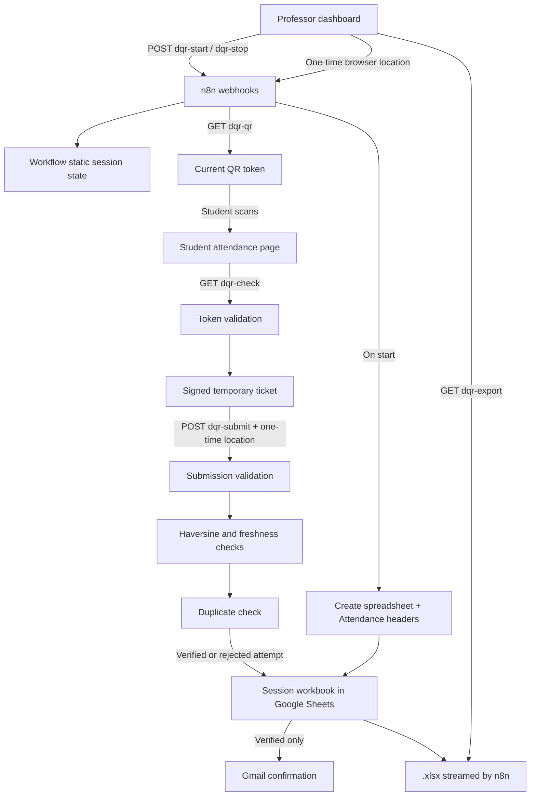

# Architecture

Dynamic QR Attendance is a small browser-to-n8n workflow. The browser interfaces are intentionally framework-free; n8n owns session state, validation, persistence, and notification.

## System Flow

## Responsibilities

### Professor dashboard

`frontend/professor-dashboard.html` starts and stops a session, polls for the current token, renders the QR code with QRCode.js, and displays the token countdown. The professor key is read from the page URL and sent to the protected professor endpoints.

It also owns the session-workbook panel
(`src/components/SessionSheetPanel.tsx`): the workbook reported by
`/dqr-start`, `/dqr-qr` and `/dqr-stop` is shown as soon as the session exists
and stays visible after the stop. *Download .xlsx* fetches `/dqr-export` and
saves the blob; if that response is not a spreadsheet (JSON error, proxy HTML,
non-2xx) the panel opens Google's own `export?format=xlsx` link instead. The
shared URL/naming rules live in `frontend/session-sheet.js` so the tests cover
the same code the dashboard runs.

### Student page

`frontend/student-attendance.html` reads the session and token from the QR URL, immediately removes them from the address bar, asks n8n to validate the scan, and submits the returned ticket with the student's form data.

### Shared location module

`frontend/location-core.js` is the single implementation of geolocation
acquisition, reading validation and the attendance decision, imported by both
the dashboard (`src/utils/location.ts`, `src/utils/lectureLocation.ts`) and the
student page. It requests high-accuracy, never-cached fixes for the student,
collects up to three readings inside a bounded window, keeps the most accurate
fresh reading, and rejects readings with out-of-range coordinates, non-positive
accuracy, missing timestamps, or stale capture times. It also validates the
professor-confirmed lecture-hall reference (coordinates + confirmation age, no
accuracy field) and exposes `assessStudentAttendance`, the same ACCEPTED/REJECTED
decision the workflow makes. The attendance radius stays on the server and is
independent of the accuracy target.

### Map and geocoding

`src/components/LocationPicker.tsx` renders a Leaflet map (no API key) inside the
control panel, with Nominatim place search and a draggable pin. The confirmed pin
is an administrative reference for where the class meets; it is not the
professor's device position and not proof of presence. Tile and geocoding URLs
come from `VITE_*` overrides in `src/config.ts`, so no secret ships in the
bundle. The student page does not load the map at all.

### n8n

`n8n/dynamic-qr-attendance.json` exposes six webhooks:

- `POST /dqr-start` — also creates that session's spreadsheet
- `GET /dqr-qr`
- `POST /dqr-stop` — returns the session sheet with its export link
- `GET /dqr-check`
- `POST /dqr-submit`
- `GET /dqr-export` — streams the session workbook as `.xlsx`

The workflow uses n8n workflow static data for the currently active session. This is appropriate for the prototype's single active session model, but it is not a substitute for a shared database in a multi-instance deployment.

### Google Sheets

Each session owns a spreadsheet, created by the workflow when the professor
presses Start: one `Attendance` tab, the 17 Attendance headers written by the
workflow (bold, frozen), and a plain-text `Student ID` column so identifiers
keep their leading zeros. The session state holds the workbook id, tab, title,
editor URL and `.xlsx` export URL; the workbook history keeps the last 20 so a
sheet can still be resolved after the session is stopped.

That session's `Attendance` tab is used both to look up existing attendance for
a session and to append new attendance rows. A submission is rejected when
either the `(Session ID, Student ID)` or `(Session ID, Device ID)` pair already
exists. The three sheet nodes take their document id from
`Validate Submission`, so nothing is ever written to another session's
workbook. A session with no workbook of its own — only possible for one already
running when the workbook step was introduced — falls back to the shared
prototype spreadsheet.

The header row is written by the Google Sheets node itself (an auto-map append
into the empty tab, which makes n8n write the input keys as row 1), so it uses
the same credential and transport as the attendance rows. A plain HTTP Request
node then applies the cosmetic formatting, and a second serves `/dqr-export` by
calling the Drive export endpoint. Both reuse the Google Sheets OAuth2
credential (`drive.file` + `spreadsheets` scopes), so no additional credential
is configured — and if either fails, the session still works: formatting is
skipped and the dashboard falls back to Google's own export link.

### Gmail

After the success response is prepared, the Gmail node sends a confirmation email to the submitted address. The node is configured to continue on email errors so a notification failure does not undo the recorded attendance.

## Trust Boundaries

The browser is untrusted. It can submit arbitrary form values and tickets, so the n8n workflow verifies the professor key, QR session/token, HMAC ticket signature, ticket expiry, session status, required fields, email shape, device ID, duplicate status, coordinate ranges, accuracy, freshness, and distance before writing to Sheets. The device ID is a persistent browser-storage identifier, not a tamper-proof hardware fingerprint. Location readings are quality signals rather than proof of physical presence and can be spoofed.

Student location is captured only during the attendance flow, not continuously.
There is no review state: an attempt is either `ACCEPTED / VERIFIED` (written to
Sheets, confirmation email) or `REJECTED / <reason>` (nothing recorded).
Imprecise student readings are re-requested first; if none meets the 50 m
accuracy target the attempt is rejected with `LOW_ACCURACY` instead of being
recorded as outside the radius. The professor's reference is a map pin, so a
coarse laptop fix cannot block or weaken the check — but it also means the
reference is only as trustworthy as the professor's pin placement.

The student page loads `frontend/location-core.js` as an ES module, so it must
be served over HTTP(S) together with its sibling module file; opening the page
from the filesystem will not initialise.

The professor key and HMAC secret are placeholders in the public export. Configure private values in the n8n workflow before activation.

`/dqr-export` is protected by the same shared professor key as the other
professor endpoints, and it can only reach workbooks this workflow created (the
id comes from workflow state, never from the request). It is a download of
student names, IDs and emails, so the professor key must stay as private as the
dashboard URL that carries it.
