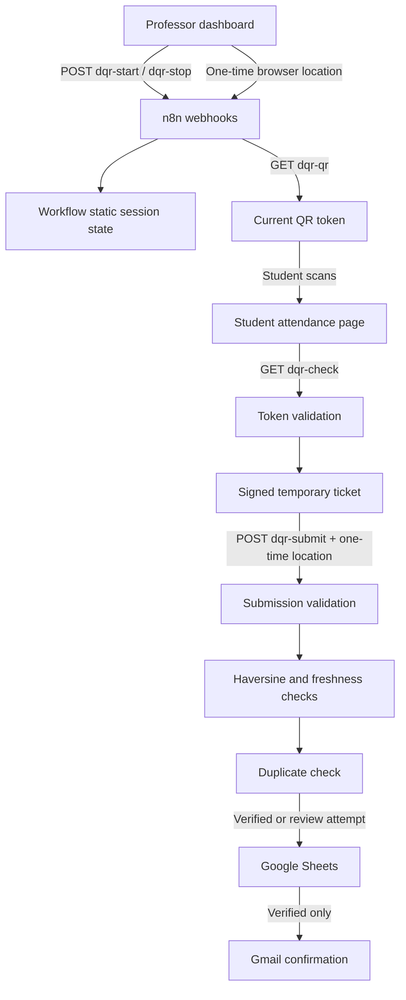

# Architecture

Dynamic QR Attendance is a small browser-to-n8n workflow. The browser interfaces are intentionally framework-free; n8n owns session state, validation, persistence, and notification.

## System Flow

## Responsibilities

### Professor dashboard

`frontend/professor-dashboard.html` starts and stops a session, polls for the current token, renders the QR code with QRCode.js, and displays the token countdown. The professor key is read from the page URL and sent to the protected professor endpoints.

### Student page

`frontend/student-attendance.html` reads the session and token from the QR URL, immediately removes them from the address bar, asks n8n to validate the scan, and submits the returned ticket with the student's form data.

### Shared location module

`frontend/location-core.js` is the single implementation of geolocation
acquisition and reading validation, imported by both the dashboard
(`src/utils/location.ts`) and the student page. It requests high-accuracy,
never-cached fixes, collects up to three readings inside a bounded window, keeps
the most accurate fresh reading, and rejects readings with out-of-range
coordinates, non-positive accuracy, missing timestamps, or stale capture times.
The attendance radius stays on the server and is independent of the accuracy
target.

### n8n

`n8n/dynamic-qr-attendance.json` exposes five webhooks:

- `POST /dqr-start`
- `GET /dqr-qr`
- `POST /dqr-stop`
- `GET /dqr-check`
- `POST /dqr-submit`

The workflow uses n8n workflow static data for the currently active session. This is appropriate for the prototype's single active session model, but it is not a substitute for a shared database in a multi-instance deployment.

### Google Sheets

The `Attendance` sheet is used both to look up existing attendance for a
session and to append new attendance rows. A submission is rejected when either
the `(Session ID, Student ID)` or `(Session ID, Device ID)` pair already exists.

### Gmail

After the success response is prepared, the Gmail node sends a confirmation email to the submitted address. The node is configured to continue on email errors so a notification failure does not undo the recorded attendance.

## Trust Boundaries

The browser is untrusted. It can submit arbitrary form values and tickets, so the n8n workflow verifies the professor key, QR session/token, HMAC ticket signature, ticket expiry, session status, required fields, email shape, device ID, duplicate status, coordinate ranges, accuracy, freshness, and distance before writing to Sheets. The device ID is a persistent browser-storage identifier, not a tamper-proof hardware fingerprint. Location readings are quality signals rather than proof of physical presence and can be spoofed.

Location is captured only during the start and attendance flows, not continuously.
The default policy is `REVIEW`: outside-radius attempts are auditable but are
not marked verified and do not receive a verified-attendance email. Imprecise
readings are re-requested first; if none meets the 50 m accuracy target the
attempt is rejected with `LOW_ACCURACY` (or `INSTRUCTOR_LOW_ACCURACY` for the
session reference) instead of being recorded as outside the radius.

The student page loads `frontend/location-core.js` as an ES module, so it must
be served over HTTP(S) together with its sibling module file; opening the page
from the filesystem will not initialise.

The professor key and HMAC secret are placeholders in the public export. Configure private values in the n8n workflow before activation.
