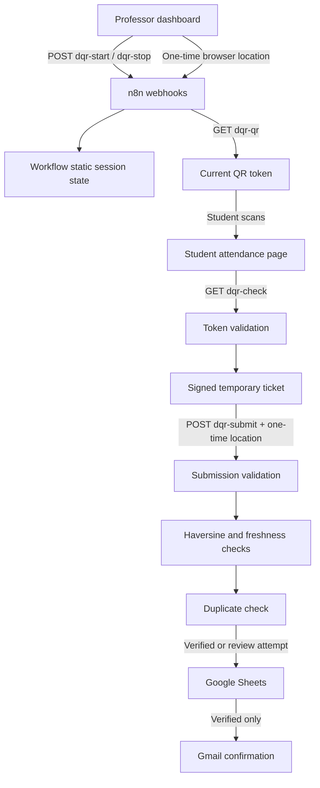

# Architecture

Dynamic QR Attendance is a small browser-to-n8n workflow. The browser interfaces are intentionally framework-free; n8n owns session state, validation, persistence, and notification.

## System Flow

## Responsibilities

### Professor dashboard

`frontend/professor-dashboard.html` is the built single-file bundle of
`frontend-aesthetic-redesign/` (React 19 + Vite + Tailwind). It starts and stops
a session, polls for the current token, renders the QR code, and shows the token
countdown. The professor key is read from the page URL, checked against
`/dqr-qr` before the console opens, and sent to the protected professor
endpoints.

It has two views on one page:

- **Console** (`#` — the default): lecture name, start/stop with an inline
  stop confirmation, the lecture-hall reference, and the live attendance
  counters from the workflow.
- **Projector** (`#projector`): a large, calm, full-screen code intended to be
  projected from a second window, with the rotation countdown, the verified
  count and the student page URL.

Layering inside `frontend-aesthetic-redesign/src`:

| Path | Responsibility |
|---|---|
| `api/attendanceApi.ts` | webhook endpoints, timeouts, response parsing, key probe |
| `hooks/useAttendance.ts` | session state, polling schedule, start/stop, lecture-hall state |
| `hooks/useHashRoute.ts` | console ⇄ projector routing without a router dependency |
| `components/ui/*` | button, panel, field, badge — the shared visual vocabulary |
| `components/*` | one panel per task: session, lecture hall, attendance, projector |
| `index.css` | design tokens (colour roles, type scale, motion) and base styles |

Business rules stay out of the views: the attendance decision lives in
`frontend/location-core.js` and the workflow, never in the dashboard.

### Student page

`frontend/student-attendance.html` reads the session and token from the QR URL, immediately removes them from the address bar, asks n8n to validate the scan, and submits the returned ticket with the student's form data.

### Shared location module

`frontend/location-core.js` is the single implementation of geolocation
acquisition, reading validation and the attendance decision, imported by both
the dashboard (`src/utils/lectureLocation.ts`) and the
student page. It requests high-accuracy, never-cached fixes for the student,
collects up to three readings inside a bounded window, keeps the most accurate
fresh reading, and rejects readings with out-of-range coordinates, non-positive
accuracy, missing timestamps, or stale capture times. It also validates the
professor-confirmed lecture-hall reference (coordinates + confirmation age, no
accuracy field) and exposes `assessStudentAttendance`, the same ACCEPTED/REJECTED
decision the workflow makes. The attendance radius stays on the server and is
independent of the accuracy target.

### Map and geocoding

`src/components/LocationPicker.tsx` renders a Leaflet map (no API key), with
Nominatim place search and a draggable pin. The map is mounted only when the
professor asks for it: the panel is otherwise a summary of the confirmed pin.
A hall whose confirmation is older than the 60-minute window can be re-confirmed
at the same coordinates in one click, or moved on the map. The picker sits
behind an error boundary so a map failure cannot take the console down. The confirmed pin
is an administrative reference for where the class meets; it is not the
professor's device position and not proof of presence. Tile and geocoding URLs
come from `VITE_*` overrides in `src/config.ts`, so no secret ships in the
bundle. The student page does not load the map at all.

### n8n

`n8n/dynamic-qr-attendance.json` exposes five webhooks:

- `POST /dqr-start`
- `GET /dqr-qr`
- `POST /dqr-stop`
- `GET /dqr-check`
- `POST /dqr-submit`

The workflow uses n8n workflow static data for the currently active session. This is appropriate for the prototype's single active session model, but it is not a substitute for a shared database in a multi-instance deployment.

### Google Sheets

The `Attendance` sheet is used both to look up existing attendance for a
session and to append new attendance rows. A submission is rejected when either
the `(Session ID, Student ID)` or `(Session ID, Device ID)` pair already exists.

### Gmail

After the success response is prepared, the Gmail node sends a confirmation email to the submitted address. The node is configured to continue on email errors so a notification failure does not undo the recorded attendance.

## Trust Boundaries

The browser is untrusted. It can submit arbitrary form values and tickets, so the n8n workflow verifies the professor key, QR session/token, HMAC ticket signature, ticket expiry, session status, required fields, email shape, device ID, duplicate status, coordinate ranges, accuracy, freshness, and distance before writing to Sheets. The device ID is a persistent browser-storage identifier, not a tamper-proof hardware fingerprint. Location readings are quality signals rather than proof of physical presence and can be spoofed.

Student location is captured only during the attendance flow, not continuously.
There is no review state: an attempt is either `ACCEPTED / VERIFIED` (written to
Sheets, confirmation email) or `REJECTED / <reason>` (nothing recorded).
Imprecise student readings are re-requested first; if none meets the 50 m
accuracy target the attempt is rejected with `LOW_ACCURACY` instead of being
recorded as outside the radius. The professor's reference is a map pin, so a
coarse laptop fix cannot block or weaken the check — but it also means the
reference is only as trustworthy as the professor's pin placement.

The student page loads `frontend/location-core.js` as an ES module, so it must
be served over HTTP(S) together with its sibling module file; opening the page
from the filesystem will not initialise.

The professor key and HMAC secret are placeholders in the public export. Configure private values in the n8n workflow before activation.
